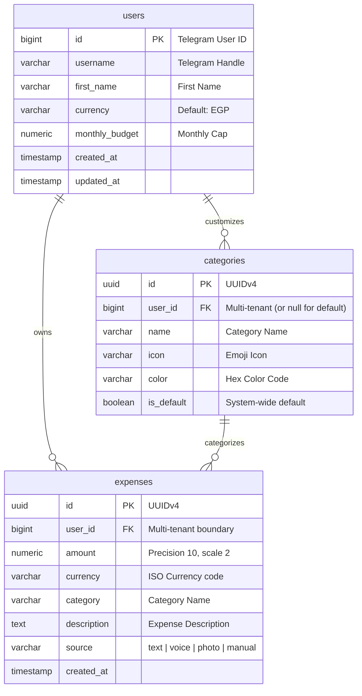

# 📊 Masareefy (مصاريفي) — Project Overview & Architecture Specification

> **AI-Powered Telegram Expense Tracker & Next.js 15 Mini App Dashboard**  
> *Production-grade, zero-cost ($0/month) multi-tenant personal finance tracker.*

---

## 1. Executive Summary

**Masareefy** is a frictionless personal finance assistant accessible directly within Telegram. It bridges conversational AI and modern web applications by allowing users to log expenses via **natural language text** (in Arabic, English, or Franco-Arabic), **voice notes**, and **receipt photos/screenshots**. 

All logged transactions are instantly parsed, categorized, and stored in a multi-tenant PostgreSQL database. Users receive real-time budget feedback and can launch a high-performance **Telegram Mini App** for deep analytics, category donut charts, spending trends, and transaction management.

### Key Milestones & Stack Choices
- **Bot Engine:** [grammY](https://grammy.dev/) running in webhook mode on Vercel Serverless Functions.
- **API Gateway:** [Hono](https://hono.dev/) mounted onto Next.js 15 App Router (`/api/[[...route]]`).
- **AI Brain:** [Google Gemini 3.5 Flash](https://ai.google.dev/) using multimodal structured JSON generation (text, audio, vision).
- **Database & ORM:** [Supabase PostgreSQL](https://supabase.com/) managed via [Drizzle ORM](https://orm.drizzle.team/) through Supavisor Transaction Pooling.
- **Frontend Dashboard:** [Next.js 15](https://nextjs.org/) (React 19, Tailwind CSS v4, Lucide icons, Recharts) running inside Telegram WebApp sandbox.
- **Total Operational Cost:** **$0.00 / month** (leveraging free tiers of Vercel, Supabase, and Google AI Studio).

---

## 2. End-to-End System Architecture

```mermaid
flowchart TD
    subgraph TelegramClient["📱 Telegram Client (Mobile / Desktop / Web)"]
        User["User"]
        ChatUI["Bot Chat Interface"]
        MiniAppUI["Mini App Webview"]
    end

    subgraph Vercel["⚡ Vercel Serverless Infrastructure"]
        Gateway["Hono API Gateway\n(/api/[[...route]])"]
        
        subgraph BotService["Bot Service (grammY)"]
            Dedup["Deduplication Cache\n(update_id & 55s timeout)"]
            RateLimit["Rate Limiter\n(5 req/min, 35/day)"]
            Router["GrammY Router & Dispatcher"]
            TextH["Text Handler"]
            VoiceH["Voice Handler (.ogg)"]
            PhotoH["Photo Handler (Receipts)"]
            CallbackH["Callbacks (Undo / Category)"]
            CmdH["Commands (/today, /month, /dashboard)"]
        end

        subgraph MiniAppService["Mini App Backend & Frontend"]
            AuthMid["Telegram HMAC-SHA256 Auth"]
            REST["REST API Endpoints\n(/api/me, /api/dashboard, /api/expenses)"]
            NextFrontend["Next.js 15 Client UI\n(React 19 + Recharts dynamic)"]
        end
    end

    subgraph ExternalServices["☁️ Cloud Services (Free Tiers)"]
        Gemini["Google Gemini 3.5 Flash\n(Multimodal & Structured JSON)"]
        Supabase["Supabase PostgreSQL\n(Supavisor Pooler :6543)"]
        TelegramAPI["Telegram Bot API\n(File Downloads & Outgoing Messages)"]
    end

    %% Client Interactions
    User -->|Sends text, audio, or receipt| ChatUI
    User -->|Taps 'Open Mini App'| MiniAppUI
    ChatUI -->|HTTPS Webhook POST| Gateway
    MiniAppUI -->|Loads WebApp + sends initData| NextFrontend

    %% Webhook Processing Flow
    Gateway -->|Incoming Webhook| Dedup
    Dedup -->|Passes Clean Updates| RateLimit
    RateLimit -->|Allowed| Router
    Router --> TextH & VoiceH & PhotoH & CallbackH & CmdH

    %% Media & AI Processing Flow
    VoiceH & PhotoH -->|Fetch raw bytes| TelegramAPI
    TextH & VoiceH & PhotoH -->|Structured Schema Prompt| Gemini
    Gemini -->|Extracted JSON {amount, category, ...}| ExpenseLogger["Expense Logger & Dedupe Guard"]

    %% Data Persistence Flow
    ExpenseLogger -->|Drizzle ORM INSERT (WHERE user_id)| Supabase
    CallbackH -->|UPDATE / DELETE| Supabase
    CmdH -->|SELECT aggregations| Supabase
    ExpenseLogger -->|Reply with [Undo] [Edit Category]| ChatUI

    %% Mini App Flow
    NextFrontend -->|API Requests with initData| AuthMid
    AuthMid -->|Verified User ID| REST
    REST -->|Isolated Tenant Queries| Supabase
```

---

## 3. How Everything Connects (Component Breakdown)

### 3.1 The Webhook & Gateway Pipeline
1. **Entry Point:** Incoming requests hit [`src/app/api/[[...route]]/route.ts`](file:///home/kal/dev/telegram_expense_tracker/src/app/api/[[...route]]/route.ts), which routes all `/api/*` traffic through Hono in [`src/server/app.ts`](file:///home/kal/dev/telegram_expense_tracker/src/server/app.ts).
2. **Telegram Webhook (`/api/webhook`):**
   - Validates that the request is from Telegram.
   - Checks the incoming `update_id` against an in-memory cache to prevent duplicate processing.
   - Passes the update to grammY's `webhookCallback` with an extended **55-second timeout**.

### 3.2 Ingestion & Multimodal AI Parsing
All inputs converge on the centralized AI service in [`src/services/ai.ts`](file:///home/kal/dev/telegram_expense_tracker/src/services/ai.ts):
- **Text Messages ([`src/bot/handlers/text.ts`](file:///home/kal/dev/telegram_expense_tracker/src/bot/handlers/text.ts)):**
  - Handles queries like `"150 coffee"`, `"دفعت 450 جنيه في السوبرماركت"`, or `"dinner with friends 600"`.
  - Gemini extracts: `amount`, `currency`, `category`, and `description`.
- **Voice Notes ([`src/bot/handlers/voice.ts`](file:///home/kal/dev/telegram_expense_tracker/src/bot/handlers/voice.ts)):**
  - Downloads `.ogg` audio files into RAM via Telegram Bot API.
  - Sends audio bytes inline to Gemini 3.5 Flash (`audio/ogg`), which performs multilingual transcription and expense extraction in a single pass.
  - Raw audio is immediately discarded from memory after inference (zero disk footprint).
- **Receipt Images & Screenshots ([`src/bot/handlers/photo.ts`](file:///home/kal/dev/telegram_expense_tracker/src/bot/handlers/photo.ts)):**
  - Downloads the highest-resolution photo from Telegram into RAM.
  - Sends the image directly to Gemini's vision pipeline to detect items, merchant name, and total amount.

### 3.3 Expense Logging & User Feedback
- Handled by [`src/bot/utils/expense-logger.ts`](file:///home/kal/dev/telegram_expense_tracker/src/bot/utils/expense-logger.ts):
  - **Duplicate Guard:** Queries the database to ensure an identical expense was not created in the last 20 seconds.
  - **Auto Category Mapping:** Matches or defaults the category from [`src/db/schema.ts`](file:///home/kal/dev/telegram_expense_tracker/src/db/schema.ts).
  - **Budget Calculation:** Computes current month spending vs. set budget limit and sends warning alerts if exceeding 80% or 100%.
  - **Interactive Telegram Actions:** Dispatches an immediate confirmation message with inline buttons:
    - `[❌ Undo]`: Calls [`src/bot/callbacks/undo.ts`](file:///home/kal/dev/telegram_expense_tracker/src/bot/callbacks/undo.ts) to instantly delete the record.
    - `[✏️ Category]`: Calls [`src/bot/callbacks/category.ts`](file:///home/kal/dev/telegram_expense_tracker/src/bot/callbacks/category.ts) to reassign the category via an inline keyboard.

### 3.4 Bot Reporting Commands
- **`/start`** ([`src/bot/commands/start.ts`](file:///home/kal/dev/telegram_expense_tracker/src/bot/commands/start.ts)): User onboarding and default currency selection (`EGP`, `USD`, `EUR`, `SAR`, `AED`).
- **`/today`** ([`src/bot/commands/today.ts`](file:///home/kal/dev/telegram_expense_tracker/src/bot/commands/today.ts)): Lists today's expenses and total spent with category breakdown.
- **`/month`** ([`src/bot/commands/month.ts`](file:///home/kal/dev/telegram_expense_tracker/src/bot/commands/month.ts)): Visual ASCII progress bar representing monthly budget utilization (`[██████░░░░] 60%`).
- **`/dashboard`** ([`src/bot/commands/dashboard.ts`](file:///home/kal/dev/telegram_expense_tracker/src/bot/commands/dashboard.ts)): Launches the Telegram Mini App via Telegram WebApp button.
- **`/export`** ([`src/bot/commands/export.ts`](file:///home/kal/dev/telegram_expense_tracker/src/bot/commands/export.ts)): Generates a clean UTF-8 CSV spreadsheet of all transactions and sends it as a downloadable file.
- **`/help`** ([`src/bot/commands/help.ts`](file:///home/kal/dev/telegram_expense_tracker/src/bot/commands/help.ts)): Complete command syntax and natural language tips.

### 3.5 The Next.js 15 Mini App Dashboard
- **Cryptographic Authentication ([`src/server/middleware/telegram-auth.ts`](file:///home/kal/dev/telegram_expense_tracker/src/server/middleware/telegram-auth.ts)):**
  - The client provides `window.Telegram.WebApp.initData`.
  - The server verifies the HMAC-SHA256 signature using the Telegram Bot Token.
  - Extracts and trusts the authenticated `user_id` without requiring passwords or cookies.
- **KPI Metrics & Visualizations:**
  - [`src/components/kpi-cards.tsx`](file:///home/kal/dev/telegram_expense_tracker/src/components/kpi-cards.tsx): Displays Total Spent, Monthly Budget, Remaining Balance, and Daily Average.
  - [`src/components/category-donut-chart.tsx`](file:///home/kal/dev/telegram_expense_tracker/src/components/category-donut-chart.tsx): Interactive breakdown of spending per category using Recharts.
  - [`src/components/spending-trend-chart.tsx`](file:///home/kal/dev/telegram_expense_tracker/src/components/spending-trend-chart.tsx): Daily spending trajectory across the current month.
- **Interactive Modals:**
  - [`src/components/add-expense-modal.tsx`](file:///home/kal/dev/telegram_expense_tracker/src/components/add-expense-modal.tsx): Web-based expense creation.
  - [`src/components/budget-settings-modal.tsx`](file:///home/kal/dev/telegram_expense_tracker/src/components/budget-settings-modal.tsx): Quick monthly budget adjustment.
- **Transaction Ledger ([`src/app/transactions/page.tsx`](file:///home/kal/dev/telegram_expense_tracker/src/app/transactions/page.tsx)):**
  - Paginated transaction history with live search, category filtering, and one-click deletion.

---

## 4. Engineering Challenges Solved & Improvements Implemented

### 4.1 Resolution of Duplicate Expense Logging (3-Layer Protection)
* **Problem:** Slower LLM calls during cold starts took ~8–12s. GrammY's default 10s webhook callback timed out, causing Telegram to re-send the exact update up to 3 times, creating triplicate database records.
* **Solution Implemented:**
  1. **55s Webhook Timeout:** Configured `webhookCallback(bot, "hono", "return", 55_000)` in [`src/server/app.ts`](file:///home/kal/dev/telegram_expense_tracker/src/server/app.ts), preventing premature timeouts.
  2. **In-Memory `update_id` Deduplication:** Built an LRU-style cache at the webhook entry point. Retried `update_id`s are immediately acknowledged with `200 OK` and dropped.
  3. **PostgreSQL 20-Second Guard:** Added a database check in [`src/bot/utils/expense-logger.ts`](file:///home/kal/dev/telegram_expense_tracker/src/bot/utils/expense-logger.ts) that skips insertion if an identical expense (same user, amount, description) exists within the last 20 seconds.

### 4.2 Dual-Layer Abuse Prevention & Rate Limiter
* **Problem:** Risk of accidental looping or malicious spam draining the Google Gemini free quota (1,500 requests/day).
* **Solution Implemented:**
  - Built [`src/bot/utils/rate-limiter.ts`](file:///home/kal/dev/telegram_expense_tracker/src/bot/utils/rate-limiter.ts):
    - **Burst Protection:** Maximum of **5 requests per minute** per user.
    - **Daily Quota:** Maximum of **35 expense logs per day** per user.
    - User-friendly warnings in Arabic & English informing the user when their cooldown expires.

### 4.3 Gemini 3.5 Flash Migration & Strict Structured JSON
* **Problem:** Google AI Studio deprecated `gemini-2.5-flash` for new API keys, returning `404 NOT_FOUND`.
* **Solution Implemented:**
  - Upgraded [`src/services/ai.ts`](file:///home/kal/dev/telegram_expense_tracker/src/services/ai.ts) to `gemini-3.5-flash`.
  - Configured `responseSchema` with JSON mode to guarantee deterministic extraction of `amount`, `currency`, `category`, and `description`.

### 4.4 Next.js 15 & Recharts SSR Webpack Fix
* **Problem:** Next.js 15 Server-Side Rendering crashed on Recharts components with `Cannot read properties of undefined (reading 'call')`.
* **Solution Implemented:**
  - Wrapped charts in `next/dynamic(..., { ssr: false })` in [`src/app/page.tsx`](file:///home/kal/dev/telegram_expense_tracker/src/app/page.tsx).
  - Added `serverExternalPackages: ["postgres", "@google/genai"]` to `next.config.ts`.
  - Added `suppressHydrationWarning` to `<html>` and `<body>` in [`src/app/layout.tsx`](file:///home/kal/dev/telegram_expense_tracker/src/app/layout.tsx) to accommodate Telegram WebApp script attribute injection.

### 4.5 Supabase IPv6 & Connection Pooling
* **Problem:** Supabase direct connections (`db.<ref>.supabase.co:5432`) are IPv6-only, causing connection failures in environments without IPv6 routing.
* **Solution Implemented:**
  - Configured Supabase Transaction Pooler (`aws-1-eu-west-1.pooler.supabase.com:6543`) in [`src/db/client.ts`](file:///home/kal/dev/telegram_expense_tracker/src/db/client.ts).
  - Set `prepare: false` to allow compatibility with Supavisor connection pooling.

---

## 5. Database Schema & Data Isolation



> **Data Privacy Guarantee:** Every database query enforces strict multi-tenant filtering (`WHERE user_id = ...`). Ephemeral media (voice notes, receipt images) is processed entirely in volatile memory and never persisted.

---

## 6. Directory Structure Reference

```
telegram_expense_tracker/
├── src/
│   ├── app/                      # Next.js 15 App Router
│   │   ├── api/[[...route]]/     # Hono catch-all route adapter
│   │   ├── transactions/         # Mini App transaction ledger page
│   │   ├── layout.tsx            # Telegram WebApp script loader
│   │   └── page.tsx              # Mini App dashboard analytics
│   ├── bot/                      # grammY Telegram Bot
│   │   ├── callbacks/            # Inline button handlers (undo, category)
│   │   ├── commands/             # Bot commands (/today, /month, /dashboard)
│   │   ├── handlers/             # Ingestion handlers (text, voice, photo)
│   │   ├── utils/                # Rate limiter & expense logger
│   │   └── index.ts              # Bot instance composer
│   ├── components/               # React UI Components
│   │   ├── category-donut-chart  # Dynamic Recharts donut
│   │   ├── spending-trend-chart  # Dynamic Recharts area chart
│   │   └── kpi-cards.tsx         # Dashboard summary cards
│   ├── db/                       # Persistence Layer
│   │   ├── client.ts             # Supabase / Supavisor connection
│   │   └── schema.ts             # Drizzle PostgreSQL schema
│   ├── server/                   # Hono Backend Application
│   │   ├── middleware/           # Telegram HMAC-SHA256 authentication
│   │   ├── routes/               # REST APIs (/dashboard, /expenses, /me)
│   │   └── app.ts                # Hono server instance & webhook handler
│   └── services/                 # AI Engine
│       └── ai.ts                 # Google Gemini 3.5 Flash structured parser
├── PROJECT_OVERVIEW.md           # This specification document
└── package.json                  # Scripts and dependencies
```

---

## 7. Verification & Operational Runbook

| Operation | Command | Purpose |
| :--- | :--- | :--- |
| **Local Dev Server** | `npm run dev` | Runs Next.js Mini App locally on `localhost:3000` |
| **Local Long-Polling** | `npm run bot:dev` | Runs the Telegram bot locally without webhooks |
| **Register Menu Commands** | `npm run bot:commands` | Syncs `/commands` menu with Telegram |
| **Configure Live Webhook** | `npm run webhook:set <URL>` | Sets webhook destination to Vercel deployment |
| **Type Check & Lint** | `npx tsc --noEmit && npm run lint` | Full codebase verification |
| **Production Build** | `npm run build` | Compiles optimized Next.js 15 bundle |
